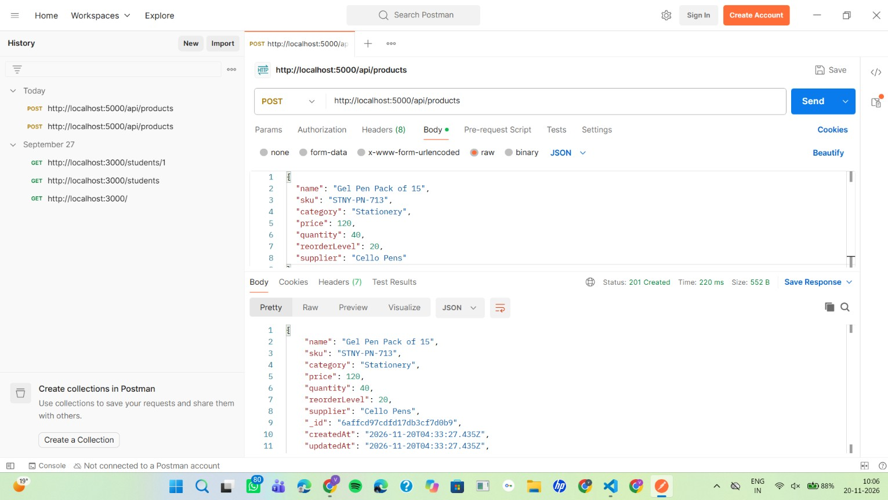
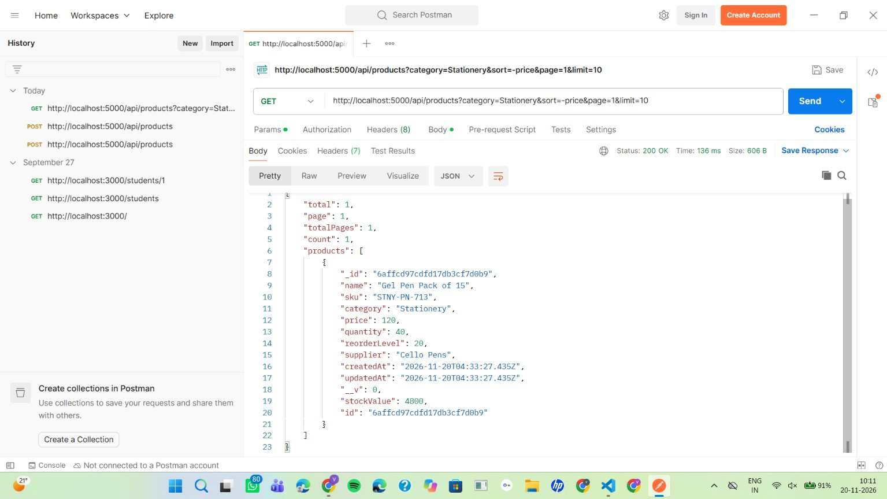
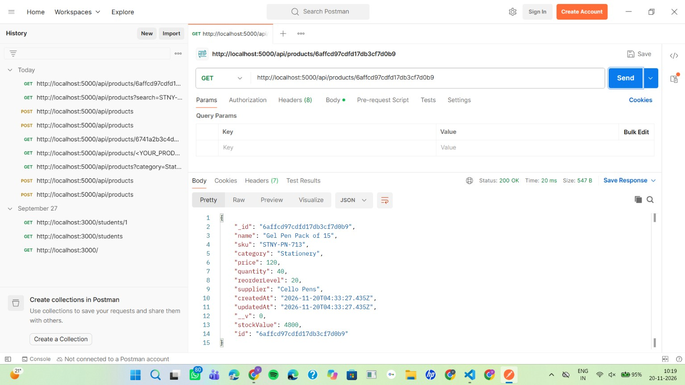
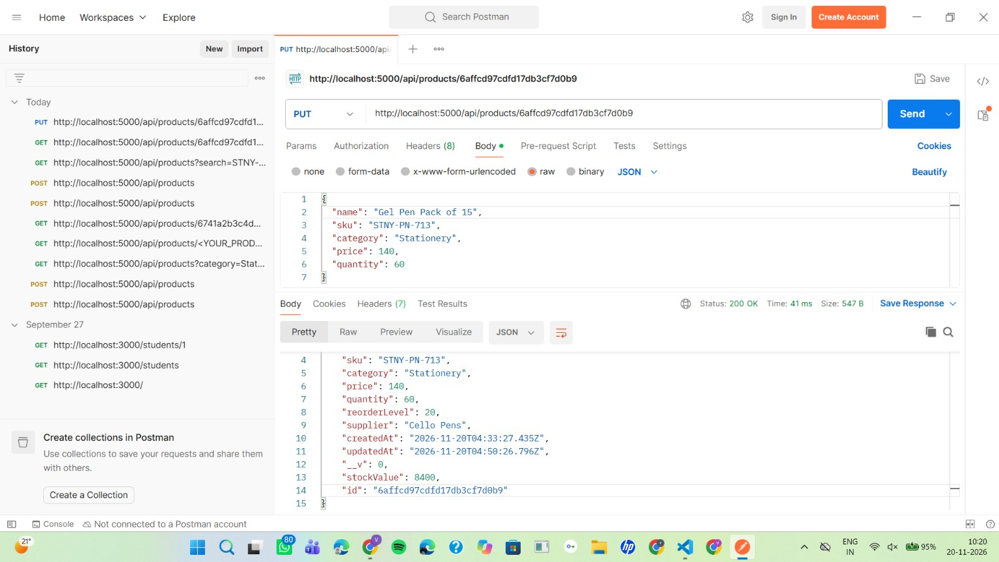
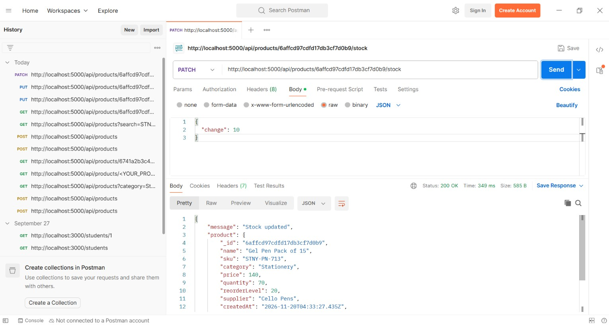
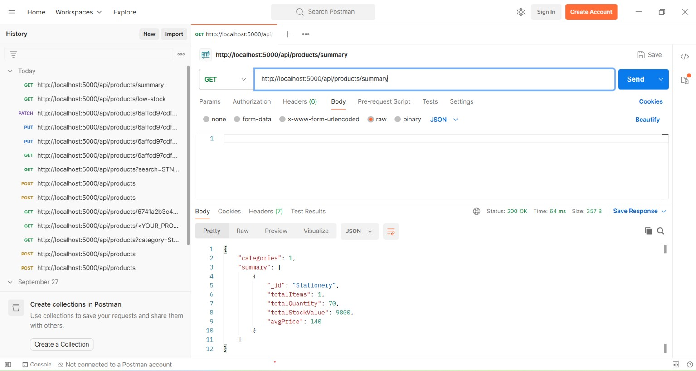
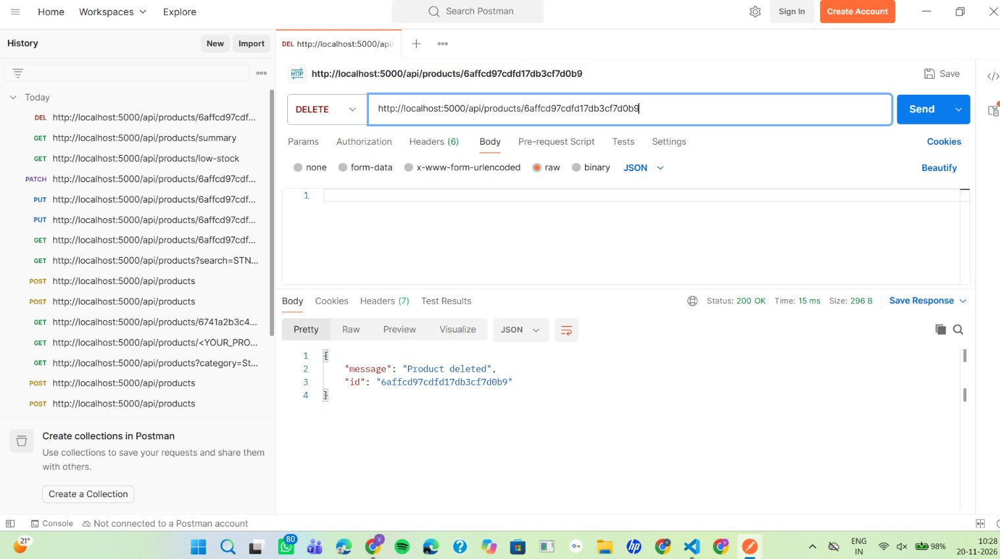

# Inventory and Data Management System

A RESTful backend API built with **Node.js**, **Express**, **Mongoose**, and **dotenv** to manage inventory products, stock updates, low-stock alerts, and category-wise summaries.

## Project Structure

```text
inventory-management-system/
├── config/
│   └── db.js
├── controllers/
│   └── productController.js
├── middleware/
│   └── errorHandler.js
├── models/
│   └── Product.js
├── routes/
│   └── productRoutes.js
├── .env
├── package.json
├── package-lock.json
└── server.js
```

## Setup & Installation

1. Install dependencies:
   ```bash
   npm install
   ```
2. Configure `.env`:
   ```env
   PORT=5000
   MONGO_URI=your_mongodb_connection_string
   ```
3. Start the server:
   ```bash
   node server.js
   ```

### Server & Database Connection


## API Endpoints & Postman Testing

| Method | Endpoint | Description |
| :--- | :--- | :--- |
| `POST` | `/api/products` | Create a new product |
| `GET` | `/api/products` | Fetch all products (filtering, sorting & pagination) |
| `GET` | `/api/products/:id` | Fetch a single product by ID |
| `PUT` | `/api/products/:id` | Update product details |
| `PATCH` | `/api/products/:id/stock` | Adjust stock quantity |
| `GET` | `/api/products/low-stock` | Low-stock alert report |
| `GET` | `/api/products/summary` | Category-wise inventory summary |
| `DELETE` | `/api/products/:id` | Delete a product by ID |

### 1. Create Product (`POST /api/products`)


### 2. Get All Products (`GET /api/products`)


### 3. Get Product by ID (`GET /api/products/:id`)


### 4. Update Product (`PUT /api/products/:id`)


### 5. Stock Adjustment (`PATCH /api/products/:id/stock`)


### 6. Low-Stock Report (`GET /api/products/low-stock`)
.jpg>)

### 7. Category Summary (`GET /api/products/summary`)


### 8. Delete Product (`DELETE /api/products/:id`)
